# Grand Voyage: Azure East Saga (Roblox)

A Ragnarok-style MMORPG on the open sea. Islands sit in a straight line (Hunting Together-style), but instead of
climbing stairs to the next stage you **build a ship and sail** there, through wind lanes, the Doldrums and NPC fleets.

> Luau + Rojo, server-authoritative. All balance lives in `src/shared/Config/`. Everything is original naming
> (no copyrighted names): see `src/shared/Config/Islands.lua`.

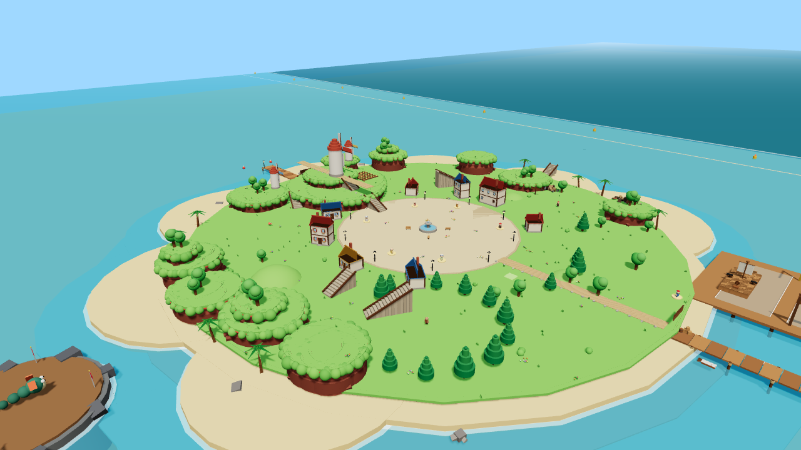

---

## Quick start

1. Open `build/GrandVoyage.rbxl` in Roblox Studio (the map is pre-baked, so you see it in edit mode).
2. **Game Settings → Security → Enable Studio Access to API Services** (needed for saving; without it the game runs but nothing is saved).
3. Press **Play**. Open ⚙️ Settings for developer buttons: `Lv70`, `+1M`, `Materials`, `Guild War`.

### Develop with Rojo

```bash
rokit install
```

```bash
rojo serve
```

Rebuild the place file (Rojo → data tests → bake map):

```bash
tools/build.sh
```

Test the UI headlessly (runs the real client UI code in Lune with mocked services, opens the HUD and all 16 windows,
fails on any runtime error) and render every screen to PNG in `build/ui/`:

```bash
lune run tools/ui_harness.luau build/GrandVoyage.rbxlx build/ui
```

Add `phone` as a third argument to simulate a phone in landscape (small screen, touch, Roblox top bar).

```bash
node tools/ui_render.js build/ui docs/screenshots/daybreak.png
```

Regenerate the placeholder sound pack:

```bash
python3 tools/gen_sfx.py
```

Upload the sounds to Roblox and write their ids into `Config/Sounds.lua` (needs an Open Cloud API key with
Assets read/write; set its IP allow-list to `0.0.0.0/0` if you run it from a server):

```bash
ROBLOX_API_KEY=<your key> python3 tools/upload_sfx.py --user 1527424396
```

Generate the low-poly Blender models (FBX + preview renders):

```bash
blender -b -P tools/blender/generate_assets.py -- --out assets/models --preview
```

---

## Controls

| Input | On land | On your ship |
|---|---|---|
| Left click | Select a monster and auto-chase/attack (Ragnarok-style) | Fire cannons at the clicked water |
| `1`–`8` | Skills (hover a slot to preview its range ring) | |
| `T` | Toggle **Auto Battle** | |
| `Tab` | Target nearest monster | |
| `W` / `S` | Move | Raise / lower sails (3 levels + reverse) |
| `A` / `D` | Move | Steer |
| `F` | | Fire at the nearest target (auto-leads moving ships) |
| `E` | | Dock (stand up from the helm first) |
| `I C K G P M B O` | Bag / Stats / Skills / Guild / Party / Map / Bosses / Settings | |
| Ship builder | Click = place, right-click = delete, `R` = rotate, `X` = delete mode | |

Mobile: the thumbstick also steers the ship (VehicleSeat). There is a ⚔️ attack button, AUTO, and ship buttons ▲▼🔥⚓.

---

## What's in the game

| System | Where |
|---|---|
| Base/Job levels, RO-style stats (STR AGI VIT INT DEX LUK) | `PlayerService`, `Modules/Formulas` |
| 6 sea-faring classes: Swordsman, Sharpshooter, Brawler Chef, Navigator, Ship Doctor, Shipwright | `Config/Classes` |
| Weapon grades: Plain → Keen → Masterwork → Grandmaster → Supreme | `Config/Items` |
| **Rarity tiers** Common → Uncommon → Rare → Epic → Legendary → Mythic → Secret (colors, shine, sounds) | `Modules/Rarity` |
| Refine +1 to +15 (safe to +4, downgrade on fail, shatter risk from +10, Willpower Charm protects) | `InventoryService` |
| 34 monster cards (boss cards Legendary, captain cards Mythic, Leviathan card Secret) | `Config/Cards` |
| Auto Battle + auto potions + per-skill auto toggles | `client/Controllers/Combat` |
| Timed MVP bosses with telegraphed slams, boss board | `BossService` |
| Instanced party dungeons (waves → boss) | `DungeonService`, `Config/Dungeons` |
| Parties with even-share EXP | `PartyService` |
| PvP: duels, Epilogue arena, Marine vs Pirate at sea, Bounty / Merit | `PvPService` |
| Guilds must choose **Marine** or **Pirate**; Guild War over 3 sea forts | `GuildService`, `GuildWarService` |
| Player vending stalls in towns (2% tax) | `MarketService` |
| **Free-form ship building**, every part has weight | `ShipyardService`, `Config/ShipParts` |
| **Sailing** with wind lane / fading edge / **Doldrums** (no wind + Leviathans) | `ShipService`, `Modules/SeaZones` |
| **Cannons** fire only as many guns as you have crew; arcs drawn on the water | `ShipService`, `client/Controllers/Sailing` |
| Marine & Pirate NPC ships in 3 tiers with different drops | `Config/NPCShips` |
| 7 detailed islands + forts + Crimson Wall / Backflow Peak (Lv70 gate) | `World/WorldBuilder`, `World/IslandLayouts`, `World/Kit` |
| **Tiered "layer-cake" terrain**: rock mesas with strata, draping grass caps, accent rims and stone stairs | `Kit.Mesa`, `IslandLayouts.TierSpecs`, `L.Ridge` |
| Hunting Together-style dashed range ring, starburst crit numbers and a COMBO counter | `Readability`, `VFX`, `UIKit.ComboHit` |
| Readability: range rings, target ring, "!" aggro, level-colored names, compass, edge arrows, nav line | `client/Controllers/Readability` |
| Graphics presets Low/Medium/High/Ultra, audio sliders, UI scale | `client/Controllers/Settings` |
| UI: Anime Vanguards-style dark panels with slanted accent tabs and icon chips, icon section headers and tab bars, **Fredoka One** display font, rarity gradients, toggles, notice bars, hover-jump motion + sounds | `client/UI/UIKit` |
| **3D-rendered icon pack** (46 icons, Blender) + anime-style particle VFX textures, auto-uploaded | `tools/blender/render_icons.py`, `tools/gen_vfx.py`, `tools/upload_images.py`, `Config/Icons`, `Config/Textures` |
| **Daily quests, achievements, titles** (Quests window, key J) | `Config/Dailies`, `Config/Achievements`, `ProgressService` |
| **Brawler** starting class, per-class progress, class switching at the Job Master | `Config/Classes`, `PlayerService` |
| **Cursed Fruits**: 6 fruits, mastery, drops + natural spawns, Seastone | `Config/Fruits`, `FruitService` |
| **Pearls** currency: daily cap, ledger, Pearl Shop, Pearl stalls with trade gates, Robux products | `Config/Pearls`, `PearlService` |
| **Sea Companions** pets: capture + eggs, evolution, follow and attack | `Config/Pets`, `PetService`, `client/Controllers/Pets` |
| **Main story + tutorial**: 40 quest steps (Daybreak tutorial, then a chapter per island), quest guide NPCs, tracker, NPC dialog, objective beacon | `QuestService`, `Config/Quests`, `client/UI/Quest` |
| **Exploration chests**: ~6 per island (Captain's Chest on the highest mesa), one-time per player, island completion bonus | `ChestService`, `Config/Chests` |
| **Swimming** with a 45 s breath limit (server-enforced) | `client/Controllers/Swim`, `PlayerService` |
| **Split level ring**: Base EXP (green) on the left half, Job EXP (class color) on the right; EXP orbs fly from the monster into it | `client/UI/HUD`, `ExpGain` push |

Design numbers: [`docs/GDD.md`](docs/GDD.md)

---

## Project layout

```
src/
  shared/            -> ReplicatedStorage.Shared
    Config/          all game data (balance here)
    Modules/         Formulas, Rarity, ShipStats, SeaZones, ShipModel, ItemDB, Net
  server/            -> ServerScriptService.Server
    Services/        one file per system
    World/           WorldBuilder (terrain/ocean/docks/API), IslandLayouts (per island), Kit (prop library), ModelFactory
  client/            -> StarterPlayerScripts.Client
    Controllers/     Combat, Sailing, Builder, VFX, Audio, Settings, Readability
    UI/              UIKit, HUD, Panels
  character/         disables default HP regen
assets/sfx/          generated placeholder sounds (upload these)
tools/               build.sh, bake.luau, test.luau, ui_harness.luau, ui_render.js, gen_sfx.py, upload_sfx.py
  blender/           generate_assets.py (low-poly FBX generator)
  roblox/            ImportHelper.lua (Studio command-bar import wiring)
assets/models/       generated FBX models, palette texture, previews
```

**Networking:** one `Request(action, payload)` RemoteFunction, a `Push` RemoteEvent, and unreliable `FX` / `ShipInput`
events (`shared/Modules/Net.lua`). Every action is validated and rate-limited on the server.

---

## Art & audio pipeline

### Models (Blender → Roblox, no code changes)

`tools/blender/generate_assets.py` builds every monster (34), ship part (18) and 11 island props as flat-shaded
low-poly meshes, reading sizes and colors from the Lua configs. Each FBX shares one palette texture
(`assets/models/textures/gv_palette.png`). Pre-generated FBX files and previews are already in `assets/models/`.

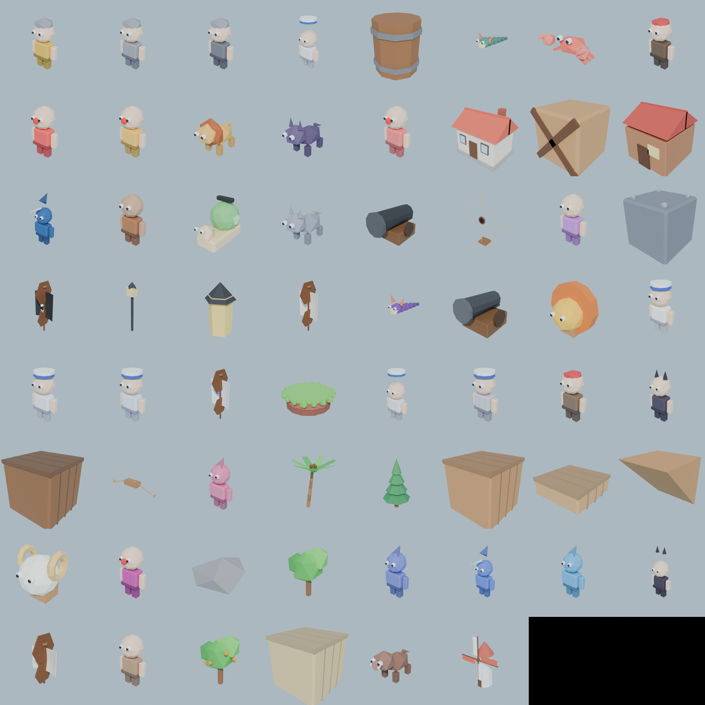

1. Studio → Import 3D → pick FBX files from `assets/models/<monsters|ships|props>/` (scale unit **Stud**).
2. Put the imported results in a folder `workspace.GV_Import`.
3. Paste `tools/roblox/ImportHelper.lua` into the Command Bar. It creates `ReplicatedStorage.Assets.Monsters/ShipParts/Props`
   (monsters get a HumanoidRootPart + Humanoid, ship parts are fitted to the 4-stud grid).
4. Press Play: the game uses these instead of the procedural placeholders.

| Folder | Name | Notes |
|---|---|---|
| `ReplicatedStorage.Assets.Monsters` | monster id, e.g. `BeachCrab` | Model with `HumanoidRootPart` + `Humanoid` |
| `ReplicatedStorage.Assets.ShipParts` | part id, e.g. `LargeMast` | PrimaryPart sized to the 4-stud grid, bow toward -Z |
| `ReplicatedStorage.Assets.VFX` | skill fx name, e.g. `Firebird` | ParticleEmitters with an `EmitCount` attribute |
| `workspace.World` | edit freely after baking | keep the `NPC` / `Dock` / `Plot` / `IslandSpawn` tags; tag pure decoration `Decor` so Low graphics can hide it |

### Sounds

`tools/gen_sfx.py` synthesizes 37 placeholder sounds into `assets/sfx/` (UI clicks, rarity reveal chimes per tier,
cannons, splashes, level-up, ocean ambience, a music loop). `tools/upload_sfx.py` uploads them through Open Cloud and
writes the `rbxassetid://` ids into `src/shared/Config/Sounds.lua` (already-uploaded files are remembered in
`assets/sfx/uploaded.json`). Until then the game falls back to built-in Roblox sounds, and music/ambience stay silent.

### UI (Figma)

Colors and fonts live in `UI.Theme` / `UI.Fonts` in `src/client/UI/UIKit.lua` (display font: Fredoka One). Icons are emoji for now; swap them
for ImageLabels in `HUD.lua` / `Panels.lua` once you have icon art.

---

## UI screenshots

Rendered from the headless UI harness (`tools/ui_harness.luau` → `tools/ui_render.js`) over an island preview, so fonts and
layout are close to Studio but not pixel-exact.

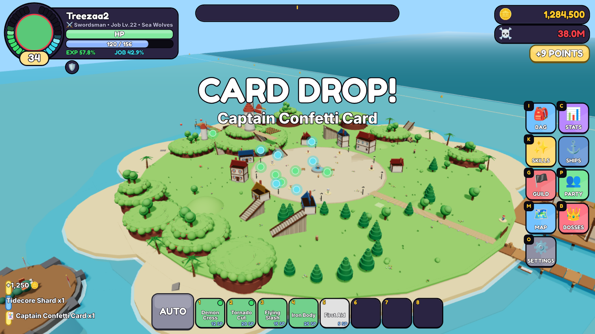

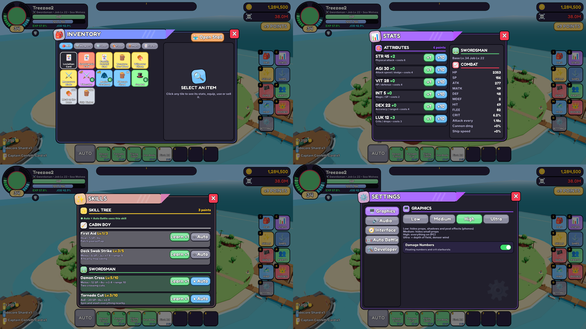

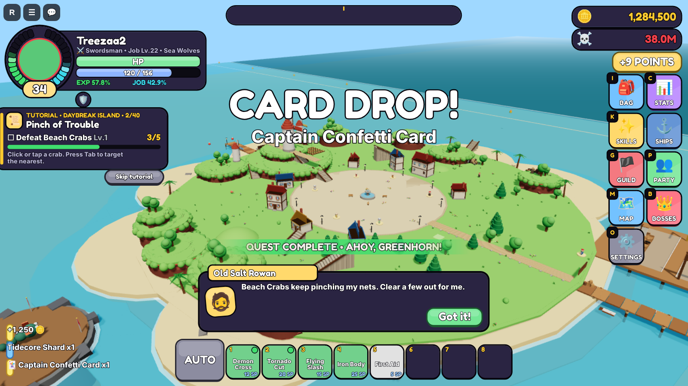

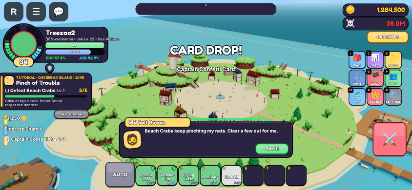

---

## Island screenshots

These are preview renders made with three.js from the baked map, not in-engine Roblox screenshots.

| | |
|---|---|
| 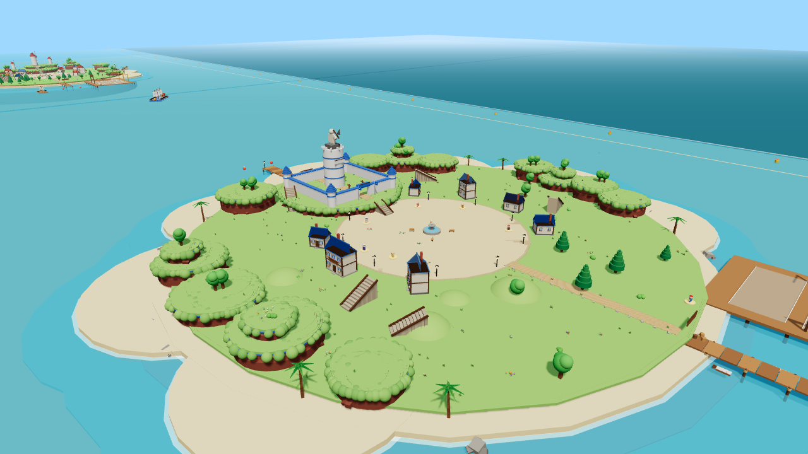 | 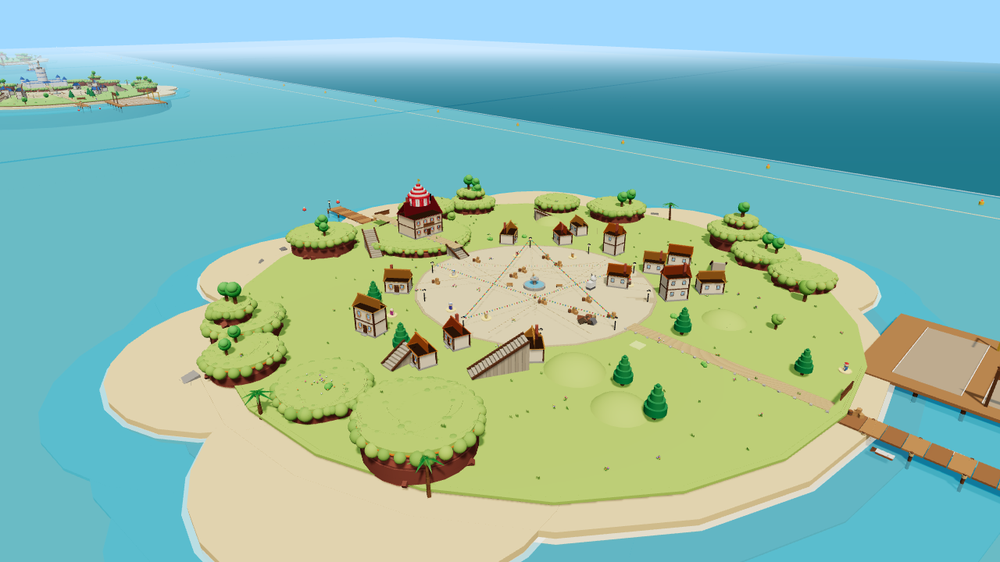 |
| 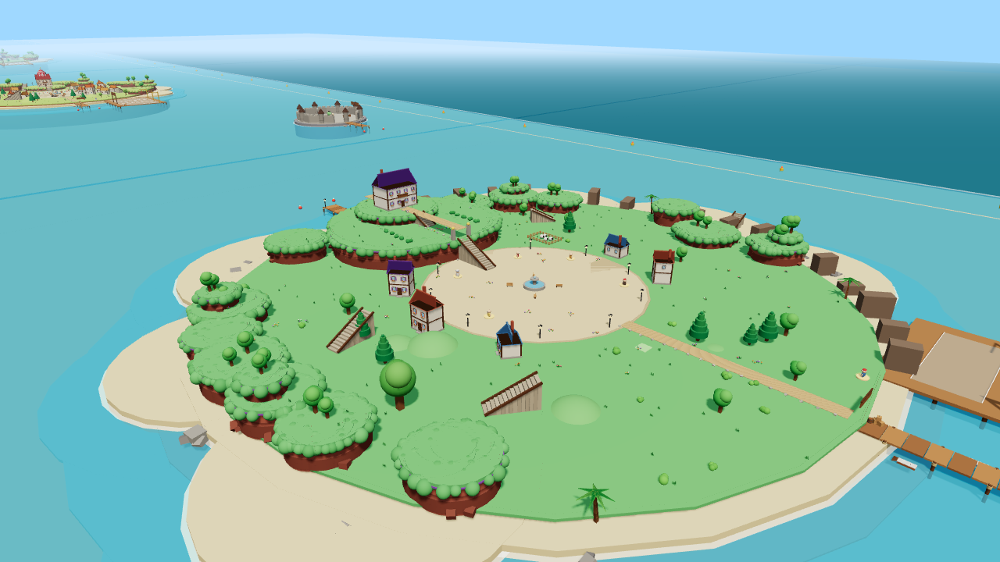 | 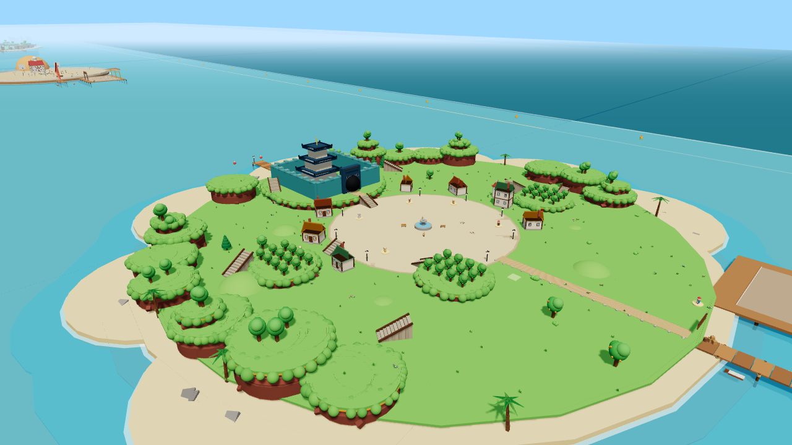 |
| 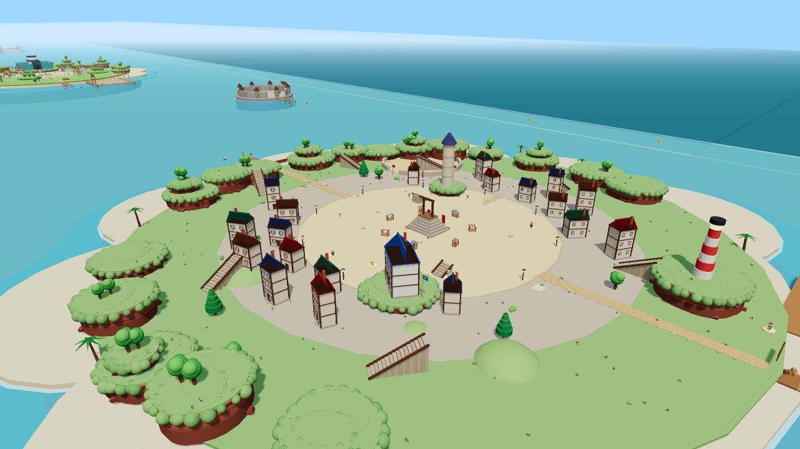 |  |
