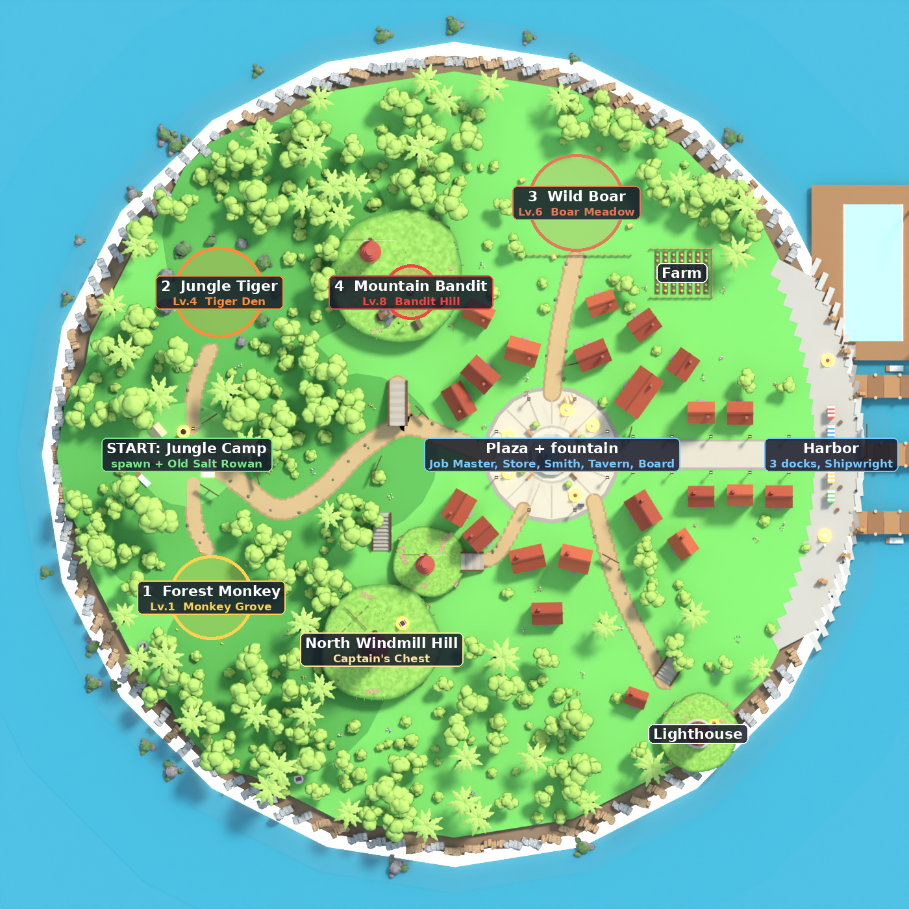

# Daybreak Island layout (v0.22)

The starting island (Lv 1-10), rebuilt after the owner's concept art. The concept shows a jungle at the back, a
winding path to a village, a stone plaza with a two-tier fountain, timber-and-plaster houses with terracotta roofs,
a lighthouse on the left coast, windmills on the hills behind the houses, a harbor with three wooden docks, rocky
shores and dense jungle.

- **Code:** `src/server/World/Daybreak.lua` (hand-laid layout). Monster zones are in `Config/Islands.lua` and the
  tutorial is `T01`-`T12` in `Config/Quests.lua`.
- **Previews** (Blender renders of the baked map with the real tree/rock meshes):
  - `docs/screenshots/daybreak_v22_map.png` (annotated top view)
  - `docs/screenshots/daybreak_v22_harbor.png`
  - `docs/screenshots/daybreak_v22_jungle.png`
  - `docs/screenshots/daybreak_v22_village.png`
- **Backup of the old island:**
  - `backups/Daybreak_v0.21_WorldV5.rbxm` (drag into Studio)
  - git tag `daybreak-before-rebuild`

## Orientation

All coordinates are offsets from the island center, in studs. The island radius is 250 and the ground is at Y 7.5.

- **+X (east):** faces the sailing route to Conch Bay. The harbor is here, and ships launch east.
- **-X (west):** the jungle. Players spawn there.
- **"Left" in the concept:** +Z, as seen from the harbor looking west. The lighthouse is on that side.

## The tutorial route (story order)

| Step | Where | What | Monster / NPC | Level |
|---|---|---|---|---|
| Start | Jungle Camp (-165, 0) | Spawn point (-152, 10); campfire, tent, washed-up rowboat; ringed by giant trees with roots and vines | Old Salt Rowan (quest guide) | |
| T02-T03 | Monkey Grove (-150, 88), north of camp, lane + signpost | First fights, then the first skill | Forest Monkey x6 | 1 |
| T04-T05 | Tiger Den (-145, -100), south of camp, ring of mossy stones with a gap facing the camp | Auto Battle, then a tougher passive mob | Jungle Tiger x5 (new) | 4 |
| T06-T07 | Back at the camp | Stats, then equip the Bandana; Rowan points east | Rowan | |
| (trail) | Winding dirt trail (-151, 6) → (22, 0) between the windmill hills, lamps every few segments | Leaves the jungle | | |
| T08 | Boar Meadow (75, -155), south of the village past the farm | Grind to Job Lv 10 | Wild Boar x5 (aggressive) | 6 |
| T09 | Village plaza (60, 0) | Pick a class | Job Master (west side of the plaza, first NPC you meet) | |
| T10 | Bandit Hill (-35, -110), a 13-stud mesa with stairs on its north side, bandit camp + windmill on top | Test the new class | Mountain Bandit x5 (aggressive, zone (-27, -100) r 17) | 8 |
| T11 | Harbor quay | Launch the ship | Shipwright (230, -58), next to the shipyard | |
| T12 | Sea | Sail to Conch Bay | | |

The order the owner asked for is monkeys → tigers → bandits before leaving. Beach Crabs are gone from the island and
Jungle Tigers took their place. Wild Boars stay as the Job Lv 10 grind between the tigers and the bandits. Each fight
zone is a little further from the spawn and a little stronger.

Aggressive mobs (boars, bandits) are kept out of the walking routes:

- Bandits sit on top of a mesa, about 65 studs from the trail.
- The meadow lane ends at the edge of the boar zone.
- Mob aggro range is 26 studs.

## Landmarks

| Place | Position | Notes |
|---|---|---|
| Plaza | center (60, 0), r 40 | Cobblestone with rings and spokes, two-tier fountain with spray and falling water, 4 benches, planters, 8 lamps, bunting from the fountain to the lamps |
| Plaza NPCs | radius ~29 around the fountain | Job Master + Bounty Board at the trail entrance (west), General Store (south, stall), Tavern Keeper (south-east, by the Sunrise Tavern), Blacksmith (north-east, anvil) |
| Houses | ring r 66 around the plaza, outer row r 98, both sides of the harbor street | `Kit.House` with `timber = true` (studs, rails, braces), cream plaster, terracotta roofs; gaps for the trail, the harbor street, the meadow lane, the lighthouse lane and the terrace lane |
| Harbor | arc of ±0.5 rad around +X, quay from r 222 to the sea wall at r 250 | Market stalls, crates, barrels, bollards; three docks at Z -42 / 0 / 42; the middle one is the launch dock (`Dock` tag); moored rowboats and a sailboat; the shipyard is south-east as before (stairs from its platform up to the quay) |
| Courier Gull Post | (228, 50) | On the quay by the north dock |
| Lighthouse | rock mesa (150, 172), r 20, stairs toward the village | White tower with brown bands, gallery, glowing lantern, terracotta cap; keeper's cottage below |
| Windmills | North Windmill Hill (-45, 115) r 32; terrace (-15, 66) r 18; Bandit Hill (-35, -110) r 36 | Three mills on hills behind the houses, as in the concept |
| Farm | (140, -112) | Fenced crop rows next to the Boar Meadow, hay bales |
| Rocky shore | ring of cliff slabs at r ~243, except the harbor | Dressed with the stylized cliff meshes; boulders in the surf; turquoise lagoon |
| Vegetation | jungle (west), woods along the north and south shores, palms on the rim | `Kit.RoundTree` / `Palm` / `Bush` (dressed with the env meshes at runtime); `plants = 260` ground plants via Greenery |

## Chests

| Tier | Position |
|---|---|
| Captain | North Windmill Hill top |
| Golden | Lighthouse rock |
| Silver | Bandit Hill top (guarded) |
| Silver | Jungle south-west (-186, -124) |
| Wooden | (-96, 200) |
| Wooden | (-100, -196) |
| Wooden | (-192, 118) |

## Kept / changed systems

- **Kept:**
  - NPC roles (Guide, JobMaster, Shop, Tavern, Blacksmith, BossBoard, Shipwright, FastTravel)
  - The launch dock attributes (`LaunchCf`, `LandCf`), the shipyard plots, the island banner and the Bay Serpent sea arena
  - Chest ids `Daybreak_1..7`, the quest ids and the reward values
- **Changed:**
  - The spawn (`IslandSpawn`) is now in the jungle camp.
  - The west dock was removed; there is nothing west of Daybreak.
- **Other islands are unchanged.**
  - `WorldBuilder` first runs the old Daybreak generation into a detached model and throws it away. This advances the
    shared random stream exactly as before.
  - The new Daybreak is then built on its own stream (`Kit.WithRng`).
- **Hermit companion:** now comes from Sea Eggs only, since its capture monster was the Beach Crab. Crab Shell (its
  evolution material) drops from Forest Monkeys.
- **Achievement:** "Crab Crusher" became "Tiger Tamer" (200 Jungle Tigers).
- **Jungle Tiger:**
  - Voxel model `Mon_JungleTiger` (orange with black stripes, white muzzle)
  - Tiger Pelt drop
  - Card: armor, STR +1, DEF +3, Max HP +50
